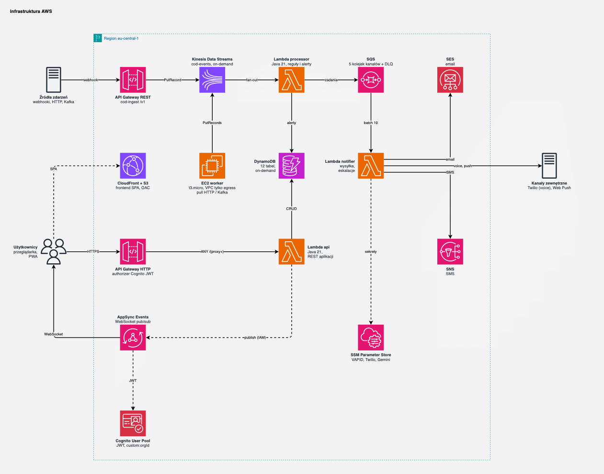

# Squawk

Five hundred errors, one alert.

Squawk is an alerting and notification service. It takes events from many
sources in many formats, turns them into alerts using rules that teams edit at
runtime, and notifies the right people by SMS, phone call, email, browser push
and a live web feed.

The application is fully implemented and live at https://squawk.com.pl. We
built it in ten hours as a team of three for Hackathon 2026 (Software
Engineering), with Claude as a fourth teammate.

## Try it

| | |
|---|---|
| Address | https://squawk.com.pl |
| Email | `jury@squawk.com.pl` |
| Password | `SquawkJury2026` |
| Role | `admin` in the demo organization |

We know that credentials in a README are unsafe. We publish them on purpose:
the account lets the jury check every screen at once, without waiting for one
of us to grant the admin role.

The demo organization receives events from five mock sources all the time. To
watch deduplication, send 500 identical errors to every source and look at the
feed:

```bash
curl -X POST 'https://datasource.squawk.com.pl/scenarios/burst?count=500'
```

## What it does

| Area | What you get |
|---|---|
| Sources | Webhooks, polled HTTP APIs and log files, Kafka topics. |
| Schemas | Each source has a parser config: `json`, `regex` with named groups, or `kv`. |
| Rules | Conditions on any field, nested ones included: `eq`, `neq`, `in`, `contains`, `regex`, `gt`, `gte`, `lt`, `lte`, `exists`. A rule sets severity, routing, templates per channel, grouping, throttling and a runbook. |
| Flood control | Identical events collapse into one alert with a counter. Throttling limits notifications per rule and per recipient. |
| Channels | SMS, email, phone call, browser push and an in-app pop-up. A rule can escalate from the least to the most intrusive channel and hold notifications outside a delivery window. |
| Live feed | Alerts reach the browser over a WebSocket. Users acknowledge, resolve, assign and annotate them. |
| Runbooks | Markdown, wiki link, checklist or plain text, shown next to the alert. |
| AI rule assistant | Describe the goal in plain language. The assistant proposes conditions from the source's recent events and reports how many of them the rule would have caught. |
| Teams | Organizations with invite codes and three roles: `admin`, `team_lead`, `user`. |
| Workspace | Each user rearranges the screen by dragging widgets. The app installs as a PWA. |

## Architecture



1. A webhook reaches API Gateway, which writes it straight to Kinesis with no
   Lambda in between. A connector worker reads pull and Kafka sources and
   writes to the same stream.
2. The processor Lambda parses the event, evaluates the organization's rules
   and stores the alert in DynamoDB with one atomic update that also handles
   deduplication.
3. The alert goes to AppSync Events and arrives in subscribed browsers over a
   WebSocket.
4. Each notification is a job on its channel's SQS queue. The notifier Lambda
   delivers it through SES, SNS, Twilio or Web Push.
5. The web application is a single-page app on S3 and CloudFront. It calls an
   HTTP API with a Cognito JWT authorizer.

## Scalability: the cloud does it

Every stage is a managed AWS service that scales by itself, so there is no
server to size and no capacity plan.

| Stage | Service | How it scales |
|---|---|---|
| Ingest | API Gateway writing to Kinesis | No Lambda on the path, so capacity is that of the two services |
| Stream | Kinesis Data Streams, on-demand | Shards follow the traffic |
| Processing | Lambda | Concurrency follows the shards |
| Storage | DynamoDB, on-demand | Billed per request, no provisioned capacity |
| Delivery | SQS and Lambda | Queues absorb spikes, the notifier scales with queue depth |
| Live feed | AppSync Events | Managed WebSocket fan-out |
| Frontend | S3 and CloudFront | Static files on a CDN |

The whole stack is one `terraform apply`. Idle, it costs about 1 USD a day for
the stream and 0.3 USD for the worker instance. Everything else is paid per
use.

## Flexibility: new sources without code

A source, a rule, a recipient group and a runbook are DynamoDB items, edited in
the UI or through the API. A change takes effect within 15 seconds, with no
deployment and no restart.

To add a source, open Sources, pick one of five presets or paste a sample
event, confirm the field mapping and save. A webhook source gets its own URL
and token. A pull or Kafka source is picked up by the connector worker on its
next 15-second refresh.

When configuration is not enough, each extension is one class:

| To add | You write |
|---|---|
| A parser format | A class implementing `Parser` |
| A notification channel or provider | A class implementing `NotificationChannel` |
| A rule operator | An entry in the operator registry |
| A connector type | A class implementing `Connector` |

The domain logic in `backend/core` has no AWS dependencies. AWS services sit
behind ports with adapters in `backend/aws`.

## Measured performance

The load test sends real webhooks and listens on the live feed like a browser,
so "end to end" runs from the HTTP request to the alert on screen. These runs
are from 21 November 2026 against the deployed stack, with the test machine in
Poland and the stack in `eu-central-1`.

200 requests per second for 30 seconds, every event its own alert:

| Run | Rejected | Lost | End to end p50 | p99 |
|---|---|---|---|---|
| 1, after idle | 0 of 6000 | 0 | 207 ms | 3921 ms |
| 2 | 0 of 6000 | 0 | 196 ms | 366 ms |
| 3 | 0 of 6000 | 0 | 195 ms | 325 ms |

A burst of 35,000 identical events at 1000 events per second produced one
alert with a count of exactly 35,000, complete 192 ms after the last event.

The account allows 10 concurrent Lambda executions, which sets today's
ceiling: at 400 requests per second everything is still delivered, but median
latency passes one second.

The load test also found a real bug. A burst once produced two alerts and a
count of 4990 instead of 5000, because two processor instances raced on the
same alert. The write is now a single atomic update.

Method, raw files and known limits: [loadtest/README.md](loadtest/README.md).

## Reliability

Each channel has its own SQS queue and dead-letter queue. A failed job is
retried three times, then goes through the dead-letter queue for two more
rounds, and every attempt is written to the alert's timeline. A failing
Kinesis batch is split in half and retried, so one bad record does not block
its shard.

## Security

- Users sign in through Cognito, and the API checks the caller's role on every route.
- AppSync admits a subscriber only to the live channels of the organization in their token.
- Each webhook source has its own ingest token.
- API keys and signing keys are in Parameter Store.
- Each Lambda's IAM role covers only what that function uses.
- The connector worker has outbound network access only.

## What is real and what is mocked

Everything runs on AWS. SMS and email go through SNS and SES in sandbox mode,
which reaches verified numbers and addresses only. Push was tested on a real
phone, and phone calls go through Twilio. The data sources are mocks: one
instance serving a JSON API, two text logs, a Kafka topic and a webhook sender
([mocks/datasource/README.md](mocks/datasource/README.md)).

## Tech stack

| Layer | Technology |
|---|---|
| Backend | Java 21, Maven. One jar for all four Lambda functions, with SnapStart. |
| AWS | Kinesis Data Streams, Lambda, DynamoDB, SQS, API Gateway, AppSync Events, Cognito, SES, SNS, S3, CloudFront, EC2, Parameter Store |
| Other services | Twilio for calls, Web Push with VAPID, Google Gemini (`gemini-flash-lite-latest`) for the rule assistant |
| Frontend | React 19, TypeScript, Vite |
| Infrastructure | Terraform |
| Mocks and load test | Python, Docker Compose, Caddy, Kafka |

## How we used AI

We agreed the contracts first (`Docs/contracts/`) and wrote tests before code.
Claude worked from the same contracts and the shared rules in `CLAUDE.md`.

## Repository

| Path | Contents |
|---|---|
| `Docs/contracts/` | Data shapes, DynamoDB tables, REST API and real-time channels |
| `backend/core/` | Domain model and logic, tested locally |
| `backend/aws/` | Adapters from the core's ports to AWS services |
| `backend/lambdas/` | Lambda handlers |
| `backend/worker/` | Connector worker for HTTP and Kafka sources |
| `frontend/` | The web application |
| `infra/app/` | Terraform for the application |
| `infra/datasource/` | Terraform for the mock data sources |
| `mocks/datasource/` | The mock data sources |
| `loadtest/` | Load test and its results |
| `demo/` | Demo data and sample API requests |

## Run it yourself

You need JDK 21, Terraform 1.5 or newer, AWS credentials and Node.js 22.12 or
newer for the frontend.

```bash
cd backend && ./mvnw package && cd ..            # tests + lambdas.jar and worker.jar
terraform -chdir=infra/app init
terraform -chdir=infra/app apply                 # the whole backend
scripts/deploy-frontend.sh                       # build the frontend and publish it
java -cp backend/lambdas/target/lambdas.jar com.claudeofduty.lambda.tools.Seed demo/seed   # demo organization
```

Settings are in `infra/app/terraform.tfvars`. To redeploy after a code change,
run the build and `apply` again. The REST API is described in
[Docs/contracts/api.md](Docs/contracts/api.md).
